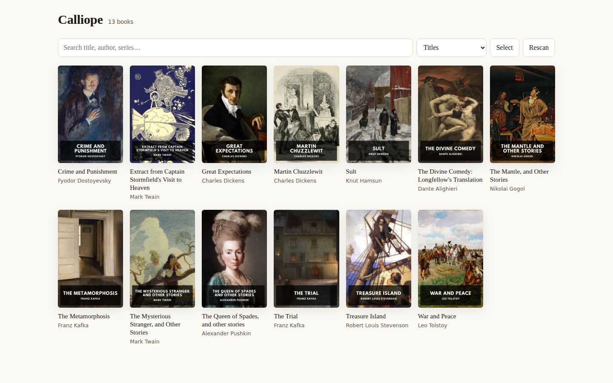
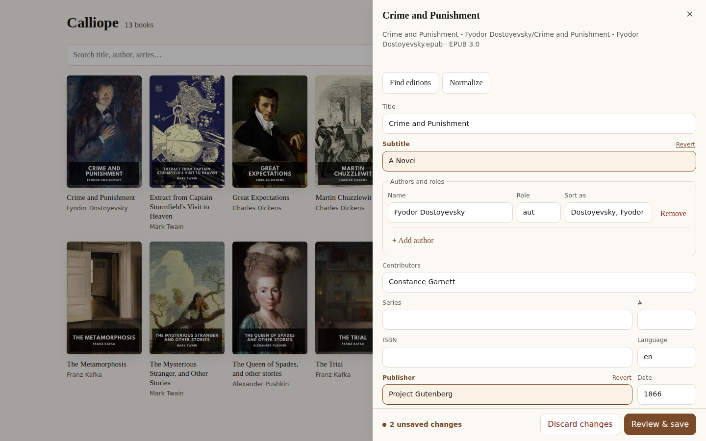
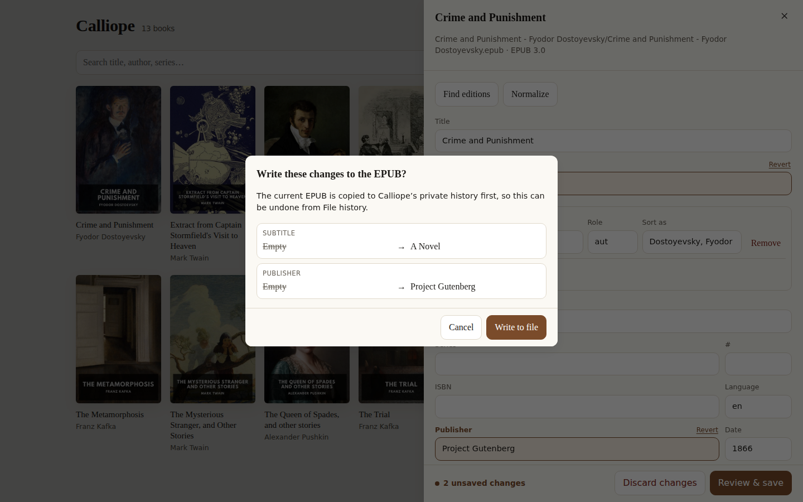
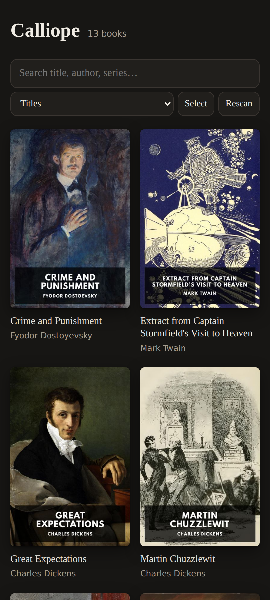

<h1 align="center">Calliope</h1>

<p align="center">
  <em>The eldest of the Muses — epic poetry and narrative literature.</em><br>
  A library manager and metadata editor for a self-hosted EPUB library.
</p>

---

Calliope manages an ebook library on disk: it scans it, indexes it, shows it, and edits the metadata
inside the EPUB files in place. It runs as a Docker container, ships as a web app, and builds to an
Android APK from the same code.

It is the library-scale successor to [EPUB BookPrep](https://github.com/gjessing1/epub-bookprep),
whose metadata engine it carries forward — the EPUB 2/3 rules, the OPF writing, the ISBN and cover
lookup. BookPrep edits one uploaded book and hands it back. Calliope edits the library.

[](assets/screenshots/library.png)

## Features

- **The whole library at a glance** — covers, titles, authors, series; search across all of them,
  sort by title, author, series, recently added or recently modified.
- **In-place metadata editing** — title, subtitle, authors and their roles, contributors, series,
  ISBN, language, publisher, date, description, subjects.
- **Standards-compliant writes** — EPUB 2 files get EPUB 2 metadata, EPUB 3 files get EPUB 3
  metadata, and the version is never upgraded. Identifiers and vendor metadata the tool does not
  understand are preserved exactly.
- **Reviewed, recoverable saves** — every staged change is marked in the form and can be reverted
  field by field or discarded outright; a before/after confirmation precedes every write; the
  current EPUB is retained in a bounded private history, where each entry shows what restoring it
  would change before any previous file or cover is restored.
- **Atomic saves** — the rebuilt file is written beside the original and renamed over it, so a
  failure never leaves a truncated book.
- **Metadata lookup** — ISBN and title search across Google Books, Open Library and Apple Books,
  always reviewed before it is applied.
- **Cover search, upload and history**, with automatic resizing and transparency flattening.
- **Batch edits** — select books (Ctrl/Shift-click, or Select) and set a series numbered by
  publication date, rename an author everywhere, set a language or publisher, add or remove
  subjects, or tidy descriptions, dates and codes. Every book's change is previewed and can be left
  out; each write is an ordinary save with its own history entry and conflict check.
- **Audiobookshelf integration** — shows each field where your reader's view and the file disagree,
  with both values, and lets you take ABS's value into the file per book or across a selection, or
  open the book in ABS to fix it there. Asks ABS to rescan after a save.
- **Web and Android** from one codebase.

## Screenshots

Stage metadata edits, revert individual fields, and review the exact changes before writing to an
EPUB. The edits below are an unsaved example draft. Select a screenshot to see it at full size.

| Metadata editor                                                                                                                                        | Save review                                                                                                                                             |
| ------------------------------------------------------------------------------------------------------------------------------------------------------ | ------------------------------------------------------------------------------------------------------------------------------------------------------- |
| [](assets/screenshots/editor.png) | [](assets/screenshots/save-review.png) |

The shared UI also adapts to phone screens and follows the device's light or dark theme. Shown here
in a mobile browser with the dark theme:

<p align="center">
  <a href="assets/screenshots/mobile.png">
    
  </a>
</p>

## Requirements

- Node 24+ (for development)
- Docker (for deployment)
- An EPUB library on disk, one folder per book
- Optionally, an Audiobookshelf instance pointed at the same directory

## Running it

```bash
docker compose -f infrastructure/docker-compose.yml up -d
```

See [infrastructure/docker-compose.yml](infrastructure/docker-compose.yml) for the full reference,
including the Audiobookshelf wiring.

### Configuration

| Variable                  | Default  | What it does                                                                                                   |
| ------------------------- | -------- | -------------------------------------------------------------------------------------------------------------- |
| `PORT`                    | `3008`   | HTTP port                                                                                                      |
| `CALLIOPE_LIBRARY_ROOT`   | `/books` | The ebook library. Mounted read-write.                                                                         |
| `CALLIOPE_DATA_DIR`       | `./data` | Index, cover cache and revisions. Keep it outside the library.                                                 |
| `CALLIOPE_REVISION_LIMIT` | `10`     | Full pre-write EPUB snapshots retained per book                                                                |
| `CALLIOPE_BACKUP_ON_SAVE` | `false`  | Keep a `.bak` beside each edited book                                                                          |
| `CALLIOPE_SCAN_ON_START`  | `true`   | Walk the library at startup                                                                                    |
| `ABS_URL`                 | —        | Audiobookshelf origin. Optional.                                                                               |
| `ABS_TOKEN`               | —        | Audiobookshelf API token. Required with `ABS_URL`.                                                             |
| `ABS_BOOKS_ROOT`          | `/books` | Where the library is mounted inside the ABS container                                                          |
| `ABS_LIBRARY_ID`          | —        | Restrict to one ABS library                                                                                    |
| `ABS_RESCAN_ON_SAVE`      | `true`   | Ask ABS to rescan after a write                                                                                |
| `ABS_PUBLIC_URL`          | —        | ABS as a browser reaches it, e.g. `https://abs.example/audiobookshelf`; enables "Open in Audiobookshelf" links |

## Development

```bash
npm install
CALLIOPE_LIBRARY_ROOT=/path/to/books CALLIOPE_DATA_DIR=./data npm run dev
```

Backend on `:3008`, Vite on `:5174` proxying `/api` to it.

```bash
npm run gate          # format, lint, build, typecheck, test — run before pushing
npm test              # tests alone
npm run build         # all workspaces, incremental
```

### Android

```bash
npm run build -w @calliope/web
cd apps/android && npx cap add android     # once
CALLIOPE_API_ORIGIN=https://your-server ./build-apk.sh
```

See [apps/android/README.md](apps/android/README.md).

## Design principles

- **The files are the truth.** The index is a cache; deleting it and rescanning loses nothing.
- **Metadata only.** Book content, structure and reading experience are never touched.
- **EPUB only.** Other formats are deliberately out of scope.
- **Nothing is applied without review.** A wrong ISBN match would rewrite a real book in a real
  library; confirmation and private revision history make that visible and recoverable.

## License

See [LICENSE](LICENSE).
